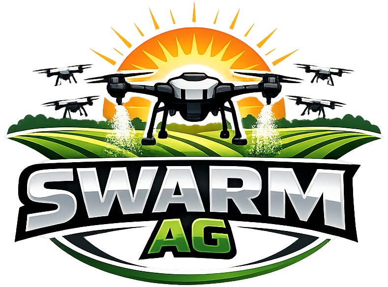

# swarmAg Operations System — User Stories

## 1. Customer Relationship Management

### 1.1 Customer Prospect

1. **Lead intake** — Leads arrive via voicemail, text, or email. A sales
   rep checks the three inboxes several times daily and transforms leads
   with substance into prospects. (Manual and managed for now; a tracked
   `Lead` abstraction with automation and measurement is parking-lotted.)
2. **Prospect genesis** — The rep runs the onboarding wizard from the lead
   artifact, before any live conversation:
   - Primary contact — capture account reachability (name, phone,
     preferred channel, email if known); no User is created at genesis.
   - Customer record — name, primary account details, address
     (billing/mailing), status `prospect`.
   - Locations/sites to service (each with label, coordinates/address,
     acreage/notes) — as known; zero sites is legal at genesis.
3. **Return call** — Outbound call to the prospect: verify captured
   details, select potential services, draft scope of effort (acreage,
   ...), and schedule the onsite assessment. (This is the assessment
   flow's entry — see 2.1.)
4. **Additional contact assignment** — Add any additional customer contact Users as account relationships.

### 1.2 Prospect Pipeline Visibility

1. **Prospects widget** — An admin dashboard widget listing current
   prospects with time-since-creation, so aging leads surface before they
   go cold.
2. **Aging charts** — Time-since-creation distribution charts (the charts
   archetype's likely first consumer). Buildable against the current
   domain (`Customer.status = 'prospect'` + `createdAt`); enriched later
   by the parked `Lead` abstraction's conversion metrics.

## 2. Job Definition

### 2.1 Preliminary Job Assessment

1. **Service selection** — Choose a Service SKU and category (aerial/ground) for the prospect’s need.
2. **Assessment scheduling** — Schedule an initial onsite assessment window and assign assessor/crew.
3. **Workflow seeding** — Preload an assessment workflow based on the Service type (default workflow per category/SKU).

### 2.2 Onsite Job Assessment

1. **Workflow tailoring** — Add or remove additional workflows/tasks to match site-specific needs or hazards.
2. **Data capture prep** — Note required artifacts (maps, photos, checklists) to collect during the assessment.
3. **Resource needs** — The rep selects the asset types and chemical types the work needs: a seed
   hopper and a drone.

### 2.3 Job Planning

1. **Scheduling** — The planner sets the job's scheduled start and duration estimate, and
   confirms the date with the customer.
2. **Equipment and chemicals** — The planner assigns actual assets of the asset types assessment
   chose (`DJI_LILLY_B123` and `DJI_FROG_A123` for the seed hopper and the drone), and chemicals
   from inventory, with amounts and target area.
3. **Workflow specialization** — The planner opens the job in the Job Builder and tailors its
   workflows further: a crew change, a different rig, a hazard learned since assessment. An
   assessment's specialized workflow is the basis for the plan's.
4. **Crew assignment** — The planner assigns each crew member a role (crew lead, pilot, visual
   observer, applicator, equipment operator, technician) and the workflows they run. The pilot
   gets the preflight; the applicator gets chemical preparation. Each person's device later shows
   only their part of the work.

### 2.4 Job Plan Finalization

1. **Plan review** — The planner reads the plan whole, as one document: schedule, crew and their
   workflows, assets, chemicals, and the assessment's notes.
2. **Readiness** — Every workflow has someone assigned, and no planned asset is in maintenance or
   retired.
3. **Finalize** — The plan is final and the job moves to `preparing`. Changing it from here means
   reopening planning, not editing in passing.

### 2.5 Job Work Preparation

1. **Take the job offline** — At base, with coverage, each crew member's device takes the job's
   working set: the job, the plan, their workflows, and the field binder's documents (labels,
   SDS). Nothing in the field needs a connection.
2. **Load-out** — The crew loads the planned assets and chemicals, following the preparation
   workflows assigned to them.

### 2.6 Onsite Job Work Preparation

1. **Arrival** — The crew lead confirms the site matches the assessment: boundaries, hazards,
   access.
2. **Preflight** — The pilot runs the preflight: obstacles, wind, people in the area. Conditions
   outside limits stop the work before it starts.
3. **Mixing** — The applicator mixes the chemicals as planned, answering the mixing workflow;
   those answers are the compliance record of what was mixed, how much, and by whom.

### 2.7 Job Work Execution

1. **Start work** — The crew lead starts the work. The job moves to `executing` and its set of
   workflows is final.
2. **Run the workflows** — Each crew member works through their own workflows on their device,
   offline. Every answer is logged with who gave it and when; telemetry (position, battery, wind)
   is logged alongside.
3. **Capture** — Photos and notes attach to answers where something is worth showing.
4. **Complete** — The crew lead completes the work. The log uploads when coverage returns, as a
   one-way append.

### 2.8 Job Work Execution Variance

1. **Deviation** — Something differs from the plan: an obstacle the assessment missed, a chemical
   running short, a gate locked. The crew records it as notes on the answers it affects; the plan
   itself does not change in the field.
2. **Stop and resume** — Wind rises past limits mid-job. The crew stops, records why, and resumes
   when conditions allow, on the same job.
3. **Escalation** — The crew lead calls the office when a deviation needs a decision; a change to
   the plan is a planning step back at base.

### 2.9 Job Followup

1. **Job report** — The office reads the uploaded log as one document: every workflow, every
   answer, who answered, deviations, photos.
2. **Application record** — The chemical application record is drawn from the applicator's
   answers and the plan's chemicals: product and EPA number, amount, area, date, applicator,
   re-entry interval.
3. **Customer report** — The customer sees their job's report in the portal.
4. **Lessons** — A question added for one job proves its worth (the pond buffer on a mesquite
   job). The office adds it to the standard workflow, so the next job starts with it.
5. **Close** — The job moves through `finalizing` to `closed`.

## 3. Workflow Development

1. **Author a standard** — An administrator builds a standard workflow in the Workflow Template
   Builder: tasks from the library, each a list of questions; new tasks and questions as needed.
2. **Reuse** — "Prepare Chemicals" serves both the aerial and the ground preparation workflows.
   Fixing it once fixes it everywhere it is used.
3. **Variation** — A variant of a task or question is a clone: a new item with its own identity.
   Answers to the original and to the variant stay distinguishable, so the two can be compared.
4. **Specialize for a job** — Assessment and planning specialize a job's workflows in the Job
   Builder, and never change the standard (2.2, 2.3).
5. **Improve from the field** — What a job teaches flows back into the standard by an
   administrator's edit (2.9).

## 4. User Management

1. **Find a user** — An administrator finds a user by name, email, role, or status.
2. **Create a user** — A new user is created with name, email, phone, preferred channel, notes,
   and roles.
3. **Edit a user** — Contact details, notes, and roles change as a person's work changes.
4. **Deactivate and reactivate** — A user who no longer needs access is deactivated and cannot
   sign in; reactivating restores access.
5. **Remove** — A user who has permanently left is removed and no longer appears.
6. **Eject** — A user no longer authorized to access the system loses that access.

_End of User Stories Document_
